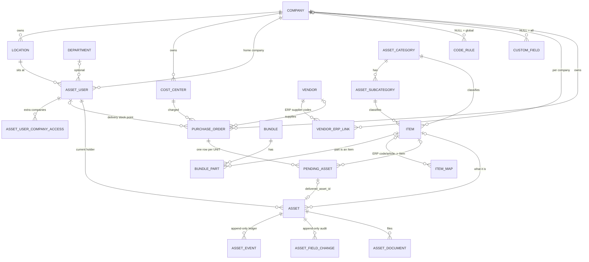
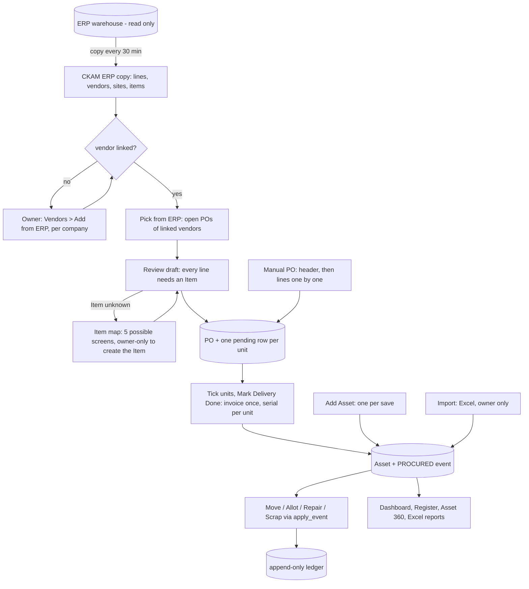

# CKAM — Current Product Architecture (as of source HEAD `fc5bda4`, 2026-10-13)

> Read-only audit. Nothing was changed in product code, database, git remote or any server.
> Source of truth is the current source, not the old AM-17 / RC reports. Where this report states a count it was
> taken from the source (OpenAPI generated by the running API, router.tsx, model files) or from the UAT sandbox copy
> of the dev database, never from older documents.
>
> This report supersedes the earlier-requested four-document set (architecture / UX audit / blueprint / flows): its content
> is folded into the six reports of this stage (see "Companion reports" at the end).

## 0. Preflight (recorded, not assumed)

| Item | Value |
|---|---|
| Worktree | `D:/ANKUR AI PROJECTS/Asset Management/.claude/worktrees/ckam-build` |
| Branch | `worktree-ckam-build` (local, never pushed this stage) |
| HEAD | `fc5bda4400fb1bdcba292da3c4ccd04f013af104` — "feat(web): Items > ERP links …" |
| Working tree | one untracked file: `backend/scripts/seed_uat_personas.py` — created by this audit to log in as each kind of user in a **throw-away UAT copy** of the app (separate ports 3311/8100/5533, own database, seeded from a copy of dev). Explained, left untracked, not part of the product. |
| Alembic | current `f6b8d0e2a4c5` = single head (dev and UAT copy) |
| Production | not touched. 10.0.1.12 not touched. |

## 1. What CKAM is today

An asset-lifecycle register for two CityKart companies (CKSPL, CKVPL). Stack: FastAPI + SQLAlchemy 2.0 async + PostgreSQL;
React 19 + Vite + TanStack Query/Router + Tailwind + shadcn/ui. One uvicorn process in production.

Size: **32 tables, 169 API operations** (166 under `/api`), **32 route definitions = 30 real screens**, **~41 dialogs, ~34 forms**,
**24 sidebar entries** for the Primary Owner. ERP warehouse (read-only) is copied into CKAM's own tables every 30 min check.

Dev data (real dev database, read-only count): 53 assets (none linked to an Item), 7 active POs with 217 PO units, 60 Items, 16 active vendors, 18 asset users, 18,361 copied ERP PO lines,
1,092 ERP items, 481 ERP sites, 217 company rows (215 are inactive store-codes left from an early import), 224 locations.

## 2. Frontend architecture

| Aspect | Current fact |
|---|---|
| Shell | Auth layout `_authed`; sidebar (groups: *Assets*, *Masters*, *Administration*) + header (Change password, Log out) |
| Route guards | **None.** Sidebar hiding only. Any logged-in user can open `/setup/*` and `/import` by URL; screens render with working-looking Add/Edit buttons and the server then answers 403. (Verified in the UAT copy as the IT operator.) |
| Data layer | TanStack Query; every master list is loaded in full (no server search/paging) except `/assets` |
| Pickers | `SearchableSelect` (type to filter, label = name only). A few plain `Select`s remain (Asset 360 Edit brand/vendor, Register category/company, Correction dialog) |
| Inline create | `QuickCreateDialog` wrappers for Category, Sub-Category, Brand, Vendor, Department, Location, Cost Centre, plus the Item form — **shown to the Primary Owner only**; every other user hits a dead end |
| Tables | One `DataTable`; PO detail shows **one row per unit** |
| Labels | Settings kept in browser localStorage per PC |

### 2.1 Route inventory (32 definitions)

| Path | Screen | Sidebar visibility | Kind |
|---|---|---|---|
| `/login`, `/change-password` | Login / forced change | public / header link | system |
| `/` , `/dispatch` | redirects (`/dispatch` → `/asset-movement`) | – | – |
| `/dashboard` | Dashboard | Admin, Operator, Viewer | reporting |
| `/my-assets` | My Assets | everyone | daily (self-service) |
| `/assets` | Asset Register | Admin, Operator, Viewer | daily |
| `/assets/new` | Add Asset (one per save) | Admin, Operator | daily |
| `/assets/$id` | Asset 360 (7 tabs) | no menu entry | daily |
| `/serial-pending` | Serial Pending | Admin, Operator | daily queue |
| `/asset-movement` | Move / Dispatch (8 actions, scan, labels) | Admin, Operator | daily |
| `/print-labels` | Print Labels | Admin, Operator | daily |
| `/purchase-orders`, `/new`, `/from-erp`, `/$id` | PO list / manual PO header / ERP picker+review / PO detail+delivery | Admin, Operator (list) | daily |
| `/import` | Import (4 tabs) | Primary Owner | bulk / setup |
| `/reports` | 3 Excel exports | Admin, Operator, Viewer | reporting |
| `/setup/companies … brands` (8) | generic master CRUD | Primary Owner | setup |
| `/setup/bundles`, `/setup/items`, `/setup/erp-articles`, `/setup/custom-fields` | Bundles, Items, ERP Articles (Codes/Articles/Groups), Custom Fields | Primary Owner | setup |
| `/setup/asset-users`, `/setup/code-rule` | Asset Users, Asset Code Rule | any role ADMIN | setup |

### 2.2 Sidebar per kind of user (exact)

| User | Entries seen |
|---|---|
| Primary Owner (24) | Dashboard, My Assets · **Assets**: Asset Register, Add Asset, Serial Pending, Move/Dispatch, Print Labels, Purchase Orders, Import, Reports · **Masters**: Companies, Locations, Departments, Cost Centers, Categories, Sub-Categories, Vendors, Brands, Items, ERP Articles, Bundles, Custom Fields · **Administration**: Asset Users, Code Rule |
| ADMIN (not owner) | as above without Import and without Masters (Asset Users and Code Rule remain) |
| OPERATOR (IT or Non-IT — identical menu) | Dashboard, My Assets, Asset Register, Add Asset, Serial Pending, Move/Dispatch, Print Labels, Purchase Orders, Reports |
| VIEWER | Dashboard, My Assets, Asset Register, Reports |
| SELF_SERVICE | My Assets |

## 3. Backend architecture

Modules (one router each): `auth`(5 ops) `asset_users`(14) `masters`(68: 8 masters × 8 + custom fields 4) `numbering/code-rules`(3)
`assets`(12) `lifecycle`(2) `documents`(3) `reports`(4) `imports`(9) `purchase_orders`(12) `bundles`(4) `erp`(18) `items`(12) + 3 in `main.py`.

Authorization tiers of the 167 `/api` operations: public 5 · any logged-in 22 · read (admin/operator/viewer) 4 ·
write (admin/operator) 32 · admin-only 13 · **Primary-Owner-only 91**.

Principles that hold in the code and must stay: backend authorization is authoritative; `lifecycle.service.apply_event` is the only writer of
`Asset.status/current_asset_user_id/status_since`; `asset_event` and `asset_field_change` are append-only (DB triggers); no hard deletes of business rows;
every schema change has an Alembic migration; serial uniqueness is also a DB partial unique index; assets move only within their own company.

## 4. Database architecture (32 tables)

| Group | Tables |
|---|---|
| Masters / config (15) | company, location, department, cost_center, asset_category, asset_subcategory, brand, vendor, vendor_erp_link, custom_field, code_rule, code_counter, item, item_map, bundle, bundle_part |
| People & access (3) | asset_user, asset_user_company_access, app_setting (**dead**: never read or written by any endpoint) |
| Purchasing (4) | purchase_order, pending_asset (one row **per unit**), purchase_order_erp_baseline, purchase_order_erp_change |
| Assets & ledger (4) | asset, asset_event (append-only), asset_field_change (append-only), asset_document |
| ERP mirror (6, system only) | erp_sync_run, erp_po_line, erp_vendor, erp_site, erp_item (+ row-hash/`is_present` bookkeeping) |

### 4.1 Entity relationship diagram

Soft (string) bridges to the ERP copy: `item_map.erp_item_code`, `vendor_erp_link.erp_vendor_code`, `purchase_order.erp_po_code`,
`asset.erp_item_code`, `asset_user.code == erp_site.short_name` for ERP-made stores.

## 5. Business domains, in business language

| Domain | What it is | Who creates it | Does the user need to know it exists? |
|---|---|---|---|
| Company | legal entity; its code is baked into every asset code | Primary Owner | only the owner |
| Location / Department / Cost centre | where, which team, which budget. Location and Department are used **only** by Asset Users; cost centre is required on every PO and asset | owner | cost centre yes (picked per PO); Location/Department no |
| Category / Sub-category | classification; Category carries IT vs Non-IT; Sub-category is part of the asset-code tokens | owner | no: the Item decides both on every asset |
| **Item** | CityKart's own name for "what we buy and manage" (Cassette AC, UPS). Decides category, sub-category, serial behaviour, bundle, default brand/warranty | owner (only) | **yes — the central concept** |
| ERP Article / ERP code | finance's grouping and per-vendor item codes | ERP | **no, but today the owner must manage them** (see audit) |
| Item map rule | "this ERP code / name / Article = this Item, or not tracked" | owner, or a PO reviewer as a side effect | no — should be invisible |
| Vendor + ERP link | supplier; one CKAM vendor ↔ many ERP supplier codes per company | owner | vendor yes, link no |
| Bundle | purchase shortcut that expands into several Items | owner | rarely |
| Asset User | anyone/anything that can hold an asset **and/or** log in: EMPLOYEE, STORE, INSTALLED (install point), STOCK_POINT | admin / ERP store import | the four kinds yes, the word "Asset User" no |
| PO + PO unit ("pending asset") | an order; a unit is one ordered physical item not yet received | writers | PO yes; "pending asset" is technical state behind "pending delivery" |
| Asset | one physical unit, with append-only history | PO delivery / Add Asset / Import | yes |
| Asset event / field change | ledger of moves and audit of edits | system | read-only history |
| Code rule | template that builds asset codes; required before any asset exists | admin | admin once |
| Custom field | extra field on every asset; **a required one blocks every PO delivery** | owner | rarely |

## 6. Authentication and RBAC

| Concept | Values | What it really controls |
|---|---|---|
| Access role | ADMIN, OPERATOR, VIEWER, SELF_SERVICE | what endpoints work (matrix in the complexity audit) |
| Primary Owner (flag on an ADMIN) | yes/no | the **only** account that may create or edit masters, Items, bundles, ERP mappings, vendors, imports (91 operations). An ordinary ADMIN cannot create a vendor, cost centre, location or Item. |
| Responsibility (IT / Non-IT) | on Category, snapshotted on each asset | which operators see which assets |
| `allowed_asset_domains` (IT / Non-IT / Both) | on Operator/Viewer | the real work-area limit — **has no field in the Add/Edit User screen**; the UAT IT/Non-IT operators had to be created by script |
| `primary_asset_domain` | stored | **read by nothing** |
| Company access | home company + extra grants | which companies an Operator/Viewer may touch |
| Asset User type | EMPLOYEE/STORE/INSTALLED/STOCK_POINT | where an asset ends up (derives its status) |
| `login_enabled` | bool | whether the row can sign in |

Creating a working login touches 11 concepts across 3 calls (create → reset-password → optional company-access).
Lockout: 5 failed logins → 15 minutes. Roles are re-read from the database on every request.

## 7. Asset lifecycle

8 statuses (IN_STOCK, ALLOTTED, INSTALLED, UNDER_REPAIR, DISPOSED, SOLD, SCRAPPED, LOST) and 11 event types.
The destination status is **derived from the destination holder's type** (employee/store → ALLOTTED, install point → INSTALLED, stock point → IN_STOCK),
so "allot", "return", "install" and "transfer" are one event (`MOVED`) with different wording. Repairs, loss, sale, scrap follow the transition table;
FOUND and CORRECTION are ADMIN-only; terminal states accept nothing. `apply_event` is the single writer.

## 8. Procurement

### 8.1 ERP integration
Read-only warehouse (`gold_ckpost.*`) is copied (both companies, `company` column) into five `erp_*` tables by a background loop. All ERP screens read the copy; the page shows "ERP data as of …".
Every ERP code is a pair (company, code). Vendors: `vendor_erp_link(vendor, company, supplier code)`. Items: `item_map` rules resolved CODE > NAME > ARTICLE > DEPARTMENT/SECTION/DIVISION (the last three can only mean *not tracked*).
Changes made later in the ERP are detected against a stored baseline and shown on the PO.

### 8.2 PO from the ERP (observed in the UAT copy)
`Purchase Orders → Pick from ERP → (list of OPEN ERP POs of linked vendors only) → Review → editable draft → Create`.
Draft pre-fills company, PO no/date, vendor, cost centre, delivery stock point and, per ERP line, description, barcode (= ERP code), quantity, cost, tax%.
Every line **needs an Item** or the Create button stays disabled. Creating a 3-line PO of quantities 50/50/4 produced **"104 lines added"** and a PO page of 104 identical rows.

### 8.3 Manual PO
`New Purchase Order` (6 fields, 3–4 required) → lands on PO detail → inline *Add Line* (11 fields, 6 required, description and barcode typed again for every line) or *Add Bundle*. Quantity N creates N pending units.

### 8.4 Delivery ("Mark N Delivery Done")
Tick units in the Pending table (one row per unit; header checkbox = all filtered rows) → dialog: 4 common fields (Initial Asset User prefilled from the PO, Invoice No, Invoice Date prefilled, Invoice Amount) +
per product group a serial textarea (one serial per line; paste/scan) with "No serial for all units" and "add later for all units" → Confirm.
Backend: one call, loop per unit (asset insert, `PROCURED` event, counter upsert, pending-unit update; ~10 queries per unit); **one bad unit rolls back the whole call**; a required custom field blocks every delivery.
PI (purchase invoice) is a separate later step (manual *Record PI* or *Fetch PI from ERP*).

## 9. Assets, serial rules, labels, movement

| Topic | Current fact |
|---|---|
| Add Asset | **one asset per Save**; 22 fields, 7 required (8 with >1 company), description and barcode typed every time; Vendor required even though a PO has it; Item defaults for brand/warranty applied, but **Item serial rule is only a preset** |
| Serial rule | Item `serial_required` + `serial_later` preset the PO unit and the checkboxes (delivery, Add Asset, bundle part); nothing enforces them. Global uniqueness except "N/A". Five phrasings of the same three states. Category/Sub-category no longer carry a serial setting (migration `f8b1d3e5a7c9`) |
| Serial Pending | list of assets saved "add later"; type a serial + Save per row, or "No serial" |
| Bundles | `bundle` + `bundle_part` expand into ordinary unit lines at PO time (ERP draft expands inline with a per-part amount grid; a second copy of the split logic lives in *Add Bundle*). Defined in 3 places (Bundles screen, Item form, PO) |
| Labels | `/print-labels`, Move/Dispatch inline printing, Asset 360 "Print Label" (prints the whole page), PO delivery "Print labels for the delivered units" ×2 — one component rendered in 5 places |
| Move / Dispatch | one batch screen: 8 actions, scan serial / asset code / QR / description, quantity multi-add, "Add by Item", "Currently With" browse, optional label printing and scan-back confirm. Other paths to the same event: Register bulk Move, Asset 360 buttons (one asset, with date and reference no), Import → Asset Movements |
| Asset 360 | header + 7 tabs (Overview, Procurement, Custody, Custom Fields, History, Changes, Documents); **no Company displayed**, Edit cannot change Item/cost centre/company/category |
| Dashboard | status tiles + Exceptions + Stock by Location + Serial Pending + ERP changes + PO card + Warranty + Allotted >180 days + Recent Activity |
| Reports | three Excel downloads only; no on-screen report |

## 10. Manual linking points (18 backend, 13 frontend surfaces)

| # | Mechanism | Surfaces |
|---|---|---|
| L1 | ERP code/name/Article → Item or *not tracked* (`item_map`) | **5 screens**: ERP Articles (Codes view, Articles view, Groups…, Codes…), Item → ERP links, PO-from-ERP line "Remember" |
| L2 | CKAM vendor ↔ ERP supplier code, per company | Vendors → Add from ERP |
| L3 | company ↔ ERP company code | Companies form |
| L4 | ERP store → Location + STORE user | Asset Users → Stores from ERP (then a password reset per store) |
| L5 | ERP delivery warehouse → stock point | automatic suggestion, picked in PO review |
| L6 | cost centre ↔ company ↔ PO/asset | picked per PO/asset |
| L7–L10 | location↔company, asset user↔company/location/department, extra company access, sub-category↔category | master forms |
| L11–L13 | Item→category+sub-category, Item↔bundle and part→Item, Item defaults | Items, Bundles |
| L14–L15 | code rule per company; custom-field scope | Administration, Masters |
| L16 | ERP purchase invoice ↔ delivered invoice no | PO detail *Fetch PI* |
| L17 | initial holder per unit/asset | Delivery dialog, Add Asset "Goes Into" |
| L18 | existing asset → Item | **no API at all** (all 53 dev assets have no Item) |

## 11. Data flow today

## 12. Technical debt that matters to users (from the source)

* Required at the API but derivable: asset `company_id` (implied by cost centre and holder, cross-checked on submit), Item `category_id` (implied by sub-category), asset-user `company_id` (implied by location), vendor on Add Asset, per-unit `initial_asset_user_id` (the PO already has a default; no call-level default exists).
* One business task needing several calls: give a person a working login (3), bring a store online (get stores → create → reset password per store), vendor for both companies (2 calls per company), Item → ERP rule (one call per rule).
* Errors only on submit: no active code rule / unknown or empty token (surfaces at first asset creation or first delivery, never when the rule is saved), cost-centre/holder/location company mismatch, required custom field blocking delivery, one bad unit failing a whole delivery, lifecycle illegalities returned as technical sentences (`event 'MOVED' is not allowed from status 'LOST'`).
* Two creation code paths (`procure_assets` vs the Excel importer) have drifted (import skips Item and ERP code).
* Dead code/config: `app_setting`, `primary_asset_domain`, the unused `operator_can_manage_masters` setting.
* Frontend leaks: raw enums (IN_STOCK, STOCK_POINT, SELF_SERVICE), "All asset_users" as a filter option, "Setup >" in 12 messages although no "Setup" menu exists, copy promising a "restore" feature that does not exist, a broken sort key (`AssetMovement.tsx:656`), My Assets showing the whole register to staff under the caption "your custody".
* Unpaginated list endpoints (POs, masters, asset users, items, ERP codes capped at 5,000).
* The ERP reminders endpoint answers 503 in the UAT copy (no live ERP link there) and the PO page keeps working; the failure is silent to the user (noted, environment-specific).

## Companion reports (same stage)

1. `CKAM_COMPLEXITY_AND_FRICTION_AUDIT.md` — what hurts, ranked, with measurements
2. `CKAM_SIMPLIFIED_OPERATING_MODEL.md` — the simple business model proposed
3. `CKAM_SIMPLIFIED_INFORMATION_ARCHITECTURE.md` — current vs proposed navigation, retire/merge matrix, per-role menus
4. `CKAM_CURRENT_VS_SIMPLIFIED_JOURNEYS.md` — before/after of every major task
5. `CKAM_SIMPLIFICATION_IMPLEMENTATION_PLAN.md` — staged plan, risk class per change
