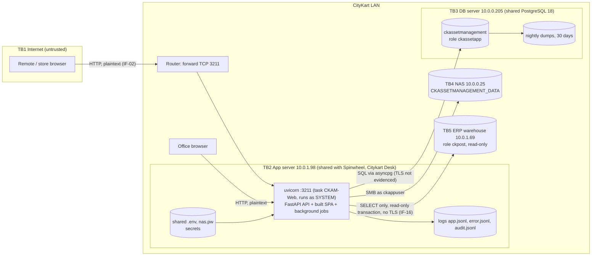

# CKAM Threat Model

| | |
|---|---|
| Date | 2026-10-16 (WP-M2b: STRIDE status column re-set from the lead's final fact sheet; new components added in sections 8.15-8.20). First version 2026-10-15 (HEAD `d04779a`) |
| Code state | Local HEAD `fd34520`: 21 local security commits, **none pushed or deployed**; production still runs `3b5e842` |
| Related reports | `CKAM_SECURITY_CLOSURE_REGISTER.md`, `CKAM_SECURITY_MASTER_HANDOVER.md`, `CKAM_VAPT_REPORT.md`, `CKAM_SECURITY_FINDINGS_REGISTER.md`, `CKAM_SECURITY_REMEDIATION_REPORT.md` (separate writer) |
| Method | Data-flow diagram, trust boundaries, STRIDE per component (Spoofing, Tampering, Repudiation, Information disclosure, Denial of service, Elevation of privilege) |
| Inputs | `docs/ai/PRODUCTION_INFRASTRUCTURE.md`, `docs/ai/ERP_INTEGRATION.md`, `docs/ai/LOGGING_AND_DIAGNOSTICS.md`, `docs/ai/DECISIONS.md`, VAPT evidence `docs/security/evidence/` |
| Finding ids | As in `CKAM_ISO27001_READINESS.md` section 6 (IF-xx, AU-xx, AC-x, IN-xx). Risk ids R-xx as in its section 9 |

**In plain words:** this document lists what is valuable in CKAM, who might attack it, through which doors,
and which lock protects each door today. A door marked *open* means a finding or external action is still
needed.

---

## 1. Assets (what we protect)

| Asset | Why it matters | Where |
|---|---|---|
| Asset register and custody history (`asset`, `asset_event`, `asset_field_change`) | The business truth: what CityKart owns and who holds it; also a finance record | PostgreSQL `ckassetmanagement` |
| Purchase orders, receipts, invoice and PI data, vendor commercial data (GSTIN, contacts) | Commercially confidential; feeds finance | PostgreSQL; ERP copy tables `erp_*` |
| Uploaded documents (invoices etc.) | Confidential | NAS `CKASSETMANAGEMENT_DATA` |
| Staff and store identities (name, code, email, phone, role, company, work area) | Personal data; drive access | `asset_user` |
| Audit trail and logs (`audit_log`, `error_log`, `system_event`, `client_report`, `*.jsonl`) | Accountability and investigation evidence; contains personal data | PostgreSQL; `logs\app` on 10.0.1.98 |
| Secrets: `JWT_SECRET`, DB password, NAS password, ERP password | Keys to everything above | `shared\.env`, `shared\nas.pw` on 10.0.1.98 |
| Backups | Recovery | `E:\DB BACKUP\...` on 10.0.0.205; dev `backups\` on 10.0.0.47 |
| Source code and release folders | Integrity of what runs | GitHub `origin`; `releases\<sha>\` |

## 2. Actors

| Actor | Trust | Typical intent |
|---|---|---|
| Internet attacker (anonymous) | None | Scan port 3211, exploit IF-01, guess passwords, DoS |
| Network eavesdropper (store Wi-Fi, ISP, LAN) | None | Read plaintext HTTP logins and cookies (IF-02) |
| Own Assets Only user (employee, store login) | Low | Curiosity: other people's or companies' data (AC-1) |
| View Only / Can Add & Move Assets user | Medium | Move or alter assets outside their area; fraud |
| Full Admin | High | Misuse across companies (D6); reset others' passwords |
| Head-office admin (Primary Owner) | Highest | Misuse; account takeover is the worst case |
| Developer / AI-assisted development session | High (code) | Mistakes; secrets leaking into code or chat |
| Server administrator of the shared servers (other apps' admins) | High (OS) | Read CKAM secrets; access DB as superuser |
| ERP warehouse operator | External, read source | Wrong or changed data; lost grants |
| Malware / ransomware on servers, NAS or dev PC | — | Encrypt or steal data |

## 3. Entry points

| Entry point | Who can reach it | Notes |
|---|---|---|
| `http://ckam.citykartstores.com:3211` / `http://10.0.1.98:3211` | Internet (router forward) and LAN | Plain HTTP; single uvicorn process serves API + SPA; no nginx in production |
| `/api/*` (217 routes in the authorization matrix) | Mostly authenticated | See section 7 |
| `/assets/{file_path}` static route and SPA fallback | Anyone | IF-01 + IF-01-WIN FIXED in code and retested (native Windows 0 of 28 leaks); **still exploitable in production** until deployed. Deep links `/assets/<id>`, `/assets/new` broken in production (CL2-IF-04), fixed in code |
| `/docs`, `/redoc`, `/openapi.json`, unknown `/api/...` | Anyone today | IF-14 / AU-11 / N6 FIXED (JSON 404 in production after deploy) |
| `/api/health`, `/api/auth/companies`, `/api/auth/login`, `/refresh`, `/logout` | Anyone | Public by design |
| PostgreSQL 5432 on 10.0.0.205 | 10.0.1.98 only for `ckassetapp` (`pg_hba`) | Superuser steps typed by the owner |
| SMB to NAS | 10.0.1.98 as `ckappuser` | |
| ERP PostgreSQL 10.0.1.69:5432 | Outbound from CKAM | Read-only role `ckpost`, no TLS (IF-16) |
| RDP / admin logon to the Windows servers | Server admins | NOT EVIDENCED who; shared with other apps |
| Git remote (GitHub) | Repository members | Ownership/MFA NOT EVIDENCED |
| Dev PC 10.0.0.47 | Local users | `.env`, dumps (IF-09) |

## 4. Trust boundaries and data flow



ASCII summary of the same picture:

```
[Internet browser]--HTTP-->[Router :3211]--+
[Office browser]---HTTP--------------------+-->[10.0.1.98 uvicorn :3211 (SYSTEM)]--SQL-->[10.0.0.205 PostgreSQL]-->[dumps on E:]
                                                    |  reads .env/nas.pw            \--SMB-->[NAS 10.0.0.25 documents]
                                                    |  writes logs\app\*.jsonl       \--SQL read-only-->[ERP 10.0.1.69]
```

| Boundary | Between | Main controls | Gaps |
|---|---|---|---|
| TB1 | Internet ↔ CKAM | Login + lockout; backend authorization on every route; per-address sign-in rate limit *(code, not deployed)* | Plain HTTP (IF-02); port-forward (EXT-05); uvicorn trusts `X-Forwarded-For` from 127.0.0.1 (N2, EXT-38) |
| Browser ↔ uvicorn (prod) / nginx ↔ api (dev only) | User device ↔ server | Same-origin SPA (no CORS); security headers (nosniff, X-Frame-Options, Referrer-Policy, `Cache-Control: no-store` on `/api/`); HttpOnly SameSite refresh cookie; in the app itself *(code, not deployed)*: path containment (IF-01), CSP + Permissions-Policy (AU-14), request-size limits (N1, AU-15), docs off (IF-14) | Cookie not Secure (AU-13, needs HTTPS); in production there is **no nginx**, so only the app's own controls apply, and they are not deployed yet |
| TB2 ↔ TB3 | API ↔ PostgreSQL | `pg_hba` limits role to 10.0.1.98/32; bound parameters; append-only triggers; TRUNCATE guards + 5-year purge floor *(code, not deployed)* | Runtime role owns tables and can drop triggers (IF-05/06 MITIGATED; EXT-07); TLS not evidenced |
| TB2 ↔ TB4 | API ↔ NAS | Dedicated NAS user; server-generated file names; 10 MB cap; extension allowlist | Password in `nas.pw` readable by SYSTEM-run process; NAS backup not evidenced |
| TB2 ↔ TB5 | API ↔ ERP | Read-only role; `default_transaction_read_only`; SELECT-only code; local copy so screens never wait on ERP; timeouts (IF-10) *(code, not deployed)* | No TLS (IF-16); SELECT-only grant not evidenced |
| OS | CKAM ↔ other apps on shared servers | Separate folders, task, DB role | Runs as SYSTEM (IF-07); shared admins |

## 5. Data stores

| Store | Content | Protection | Gap |
|---|---|---|---|
| `ckassetmanagement` | All business data, audit, ERP copy; *(code, not deployed)* `auth_session` (refresh sessions: SHA-256 of the token id only) | App role not superuser; pg_hba; triggers; *(code)* lifecycle-field guard | Owner = runtime role until the role split (`ops/db/`, EXT-07); encryption at rest NOT EVIDENCED |
| `shared\.env`, `shared\nas.pw` | Secrets | Administrators/SYSTEM only | Readable via IF-01 until deployed; rotation pending (EXT-02) |
| `logs\app\*.jsonl` | Access, error, audit lines | Server-only; redacted | Same server; rotation 20 MB x 11 |
| NAS folder | Documents | NAS user | Backup NOT EVIDENCED |
| Nightly dumps (10.0.0.205) | Full DB copy | Server ACL (NOT EVIDENCED) | Unencrypted, same server (IF-08) |
| Dev PC `backups\`, `.env` | Dev dumps, dev secrets, real ERP copy | gitignored | ACL (IF-09) |

## 6. External dependencies, privileged operations, sensitive information

- **External dependencies:** ERP warehouse (data); NAS; PostgreSQL 18; Python 3.13 runtime and 57 Python packages (`backend/constraints.txt` added, IF-11, not yet used by the production install; python-jose/ecdsa advisories, IF-12 ACCEPTED); 141 npm production packages (0 known vulnerabilities at the closure re-check; one dev-only HIGH in a build tool, OBS-NPM-DEV); Google Fonts CDN in production until deploy (self-hosted in code, `79dbae7`); GitHub (source); the AI coding assistant used in development. python-jose / ecdsa have no fixed versions (not reachable, ACCEPTED; PyJWT replacement EXT-47).
- **Privileged operations:** grant/revoke head-office admin; change access level, company access or work area; reset/issue passwords; code-rule changes; companies, places, departments, custom fields; bulk import; ERP Inbox / mapping / sync / stores from ERP; moving a Category or Item to the other work area; audit purge function (`ckam_purge_audit_log`, guarded); diagnostics and logs screens; deploy, migration, secret rotation, DB superuser steps (server side).
- **Sensitive information:** secrets (section 5); password hashes; temporary passwords (shown once); vendor GSTIN and contacts; invoice/PO values; staff personal data; IP addresses and typed login ids in failed sign-ins; client-report breadcrumbs.

## 7. Attack-surface inventory (from `docs/security/evidence/access/authz_matrix.csv`)

217 routes were classified by intended access and tested with 11 personas (no token, malformed token, Own Assets
Only, View Only, Can Add & Move IT, Can Add & Move Non-IT, Full Admin IT, Full Admin Non-IT, Full Admin Both,
other-company user, head-office admin).

| Classification | Meaning | Routes |
|---|---|---|
| PUBLIC | No login: `/api/health`, `/api/auth/companies`, `/api/auth/login`, `/refresh`, `/logout`, `/assets/{file_path}`, SPA catch-all | 7 |
| AUTH | Any signed-in user (incl. Own Assets Only) | 26 |
| READ | Staff roles (View Only and above) | 7 |
| WRITE | Can Add & Move Assets and above | 47 |
| SMALL_CREATE | In-flow creation of small records (vendor, brand, cost centre, stock room) | 9 |
| DOMAIN_ADMIN | Full Admin within work area | 13 |
| ADMIN | Full Admin | 13 |
| PRIMARY_OWNER | Head-office admin only | 95 |
| **Total** | | **217** |

Not in the matrix but reachable: FastAPI's `/docs`, `/redoc`, `/openapi.json` (IF-14). Result of the run:
467 access-control cases, 451 pass, 15 fail (AC-1 self-service setup lists, AC-2 custom fields cross-company:
both now FIXED and retested), 1 n/a; **zero privilege escalation**, confirmed again in the final retest. After
deploy, `/docs`, `/redoc` and `/openapi.json` are off in production (IF-14 FIXED). The 122 write routes are classified for audit
in `docs/security/evidence/auth/audit_coverage.csv` (107 audited, 15 intentionally not).

---

## 8. STRIDE per component

Legend for **Status**: `CONTROLLED` (control in place in production and evidenced), `FIXED (not deployed)`
(fixed in a local commit and retested; production still runs `3b5e842` without it until EXT-01), `MITIGATED`
(residual remains), `ACCEPTED`, `PARTIAL`, `OPEN` (finding or external action pending). Statuses re-set on
2026-10-16 from the lead's fact sheet; where a row changed, the 2026-10-15 status is given in brackets.

### 8.1 Frontend (React SPA)

| STRIDE | Threat | Control | Evidence / finding | Status |
|---|---|---|---|---|
| S | Fake CKAM page (phishing) collects passwords | HTTPS with a public certificate lets users verify the site | IF-02, EXT-04 | OPEN |
| T | Script injected via stored data (vendor name, client report) | React escaping; no `dangerouslySetInnerHTML` with data | `input/xss_results.json`, `raw_sql_review.md` s.4 | CONTROLLED |
| T | Clickjacking | `X-Frame-Options: SAMEORIGIN` | AU-T057 | CONTROLLED |
| I | Source maps reveal code | No source maps in the build | AU-12 FIXED (`4fa5c9b`) | FIXED (not deployed) |
| I | Third-party font CDN sees user IPs | Self-hosted Inter + IBM Plex Mono; CSP without Google hosts; `check:build` refuses external hosts | FONTS FIXED (`79dbae7`, `b401e9f`); retest 2: 0 Google requests | FIXED (not deployed) (was OPEN) |
| I | Open redirect after login | `safeNextPath()` | `raw_sql_review.md` s.5 | CONTROLLED |
| E | Hidden buttons used directly | Backend is authoritative; screen only hides | `access/authz_matrix.csv` | CONTROLLED |
| — | No Content-Security-Policy | CSP + Permissions-Policy on responses | AU-14 FIXED (`4fa5c9b`, `ae706bb`); `backend/tests/test_vapt_headers_and_docs.py` | FIXED (not deployed) |
| S | Stale screen after sign-out shows data | Clean sign-out and session-ended notice | `4fa5c9b`; `frontend/e2e/security.spec.ts` | FIXED (not deployed) |

### 8.2 API (FastAPI, single uvicorn process)

| STRIDE | Threat | Control | Evidence / finding | Status |
|---|---|---|---|---|
| I | Arbitrary file read through `/assets/{file_path}` (incl. Windows path forms) | Lexical refusal before any filesystem call, then containment (resolve + is_relative_to) and symlink refusal | IF-01 FIXED `3e134c1`, IF-01-WIN FIXED `7b039fb`; native Windows 0 of 28 leaks; **production still exposed** until EXT-01 + EXT-02 | OPEN (prod) / FIXED in code |
| I | API docs reveal every route; unknown `/api` paths reveal framework behaviour | Docs off in production; JSON 404 for docs paths and unknown `/api` | IF-14 / AU-11 FIXED (`ae706bb`), N6 FIXED (`7b039fb`, `b401e9f`) | FIXED (not deployed) |
| I | Version banners | Banner removed; uvicorn `--no-server-header` | AU-15 FIXED (`4fa5c9b`, `d04779a`); server banner FIXED (`ca94574`); production launcher flag EXT-38 | FIXED (not deployed) |
| S | Forged client address via `X-Forwarded-For` from 127.0.0.1 | uvicorn `--no-proxy-headers` in every repository launch path; app believes only `TRUSTED_PROXIES`; nginx overwrites the header (dev) | N2 code side FIXED (`a3e8fce`, `79dbae7`), N3 FIXED; `backend/tests/core/test_n2_forwarded_for.py`; production launcher still EXT-38 | FIXED (not deployed) (was OPEN) |
| T | SQL injection | ORM / bound parameters; sort whitelist; escaped LIKE | `input/raw_sql_review.md` s.1, `input/battery_results.json` | CONTROLLED |
| T | SSRF, command injection, unsafe deserialization | None of these sinks exist | IN-T111, IN-T112 | CONTROLLED |
| D | Large uploads, imports or bodies exhaust memory | Bounded reads, 15 MB import cap; request-size limits 413 (64 KB sign-in, 5 MB JSON, 16 MB uploads) | IN-02 FIXED (`ba04371`), N1 FIXED (`d04779a`), `backend/tests/core/test_body_limit.py` | FIXED (not deployed) |
| T | Same-name vendor/brand/category created twice by concurrent requests or imports | Advisory lock + duplicate check on every create and import path; friendly 422 for the loser | RACE-1 FIXED (`da790d1`, `7b039fb`), CL2-SE-N01/N03 FIXED (`fafa225`); burst tests x20 no duplicates | FIXED (not deployed) |
| D | Internet DoS on 3211 | Port-forward decision; proxy | EXT-05 | OPEN |
| E | Process compromise = server compromise | Low-privilege service account | IF-07, EXT-06 | OPEN |
| I | Errors leak internals | Controlled 4xx/5xx with request id only | AU-T078 | CONTROLLED |

### 8.3 JWT / session

| STRIDE | Threat | Control | Evidence / finding | Status |
|---|---|---|---|---|
| S | Forged token with a placeholder or weak secret | Start-up refusal in production (secret ≥ 32 characters, ≥ 8 distinct); any unknown `ENVIRONMENT_NAME` counts as production | IF-04 / AU-09 FIXED (`7e57844`), N4 FIXED (`d04779a`); `backend/tests/core/test_production_secret_guard.py` | FIXED (not deployed) |
| S | Forged token with a **stolen** secret (via IF-01) | Rotate secret after the fix | EXT-01, EXT-02 | OPEN |
| S | `alg:none`, tampered payload, refresh used as access | HS256 pinned; type claim checked | AU-T017..AU-T024 | CONTROLLED |
| I | Token or cookie sniffed on the network | HTTPS + Secure cookie | IF-02, AU-13 | OPEN |
| S | Refresh token still valid after logout | `token_version` revocation on sign-out | AU-05 FIXED (`ae706bb`, migration `f9a1c3e5b7d2`) | FIXED (not deployed) |
| S | Old refresh token reusable (stolen cookie) | Server-side `auth_session`: rotate once; reuse ⇒ 401 + every session of that person ended + `REFRESH_REUSE` row; 10 s grace for parallel tabs | AU-06 FIXED (`69c3a51`, migration `b5d7f9a1c3e5`); residual grace window R-34 (section 8.15) | FIXED (not deployed) (was MITIGATED) |
| E | Disabled login or changed rights keep working up to 15 min | `token_version` bumped **atomically** on login switch-off, deactivation, role, work-area, company-access or password change; server-side refresh sessions ended too | AU-07 FIXED; OBS-TV FIXED (`69c3a51`); `backend/tests/auth/test_vapt_sessions.py`, `test_wpa2_token_version_atomic.py` | FIXED (not deployed) |
| E | A session never expires while it keeps being renewed | Absolute session lifetime | No absolute lifetime today; decision SD-14 / EXT-50 (R-38) | OPEN (decision) |
| S | CSRF on refresh | SameSite=Lax, no CORS, JSON API | AU-T053..AU-T055 | CONTROLLED |
| S | Password guessing / enumeration | Lockout 5 / 15 min; generic 401; rate limit 429 (20 sign-ins per minute per address, also per login id); constant-time sign-in; race-safe counter | AU-01, AU-03, AU-16 FIXED (`ae706bb`); AU-04 MITIGATED (residual lock-out DoS); AU-02 ACCEPTED (423 for any password on a locked account, so it is not a guessing oracle); users behind one NAT share the per-address limit (EXT-40) | FIXED (not deployed) |
| S | Stolen password alone is enough | MFA | MFA absent, EXT-19 | OPEN |

### 8.4 Database (PostgreSQL)

| STRIDE | Threat | Control | Evidence / finding | Status |
|---|---|---|---|---|
| T | Rewrite asset history or audit rows | UPDATE/DELETE triggers on 4 append-only tables; `asset_code` immutable | `infra/db_02_*.out.txt`, `db_03` A1-A5 | CONTROLLED (app role) |
| T | TRUNCATE audit tables; purge flag used to delete recent audit rows | TRUNCATE guards; purge refused for rows younger than 5 years | IF-05/AU-10, IF-06 (`ae706bb`, migration `a3c5e7f9b1d4`); `backend/tests/observability/test_vapt_append_only.py` | MITIGATED (not deployed) |
| T | Owner or superuser disables or drops the triggers | Owner / migrator / runtime role split | `db_03` A8, C1-C3; scripts `ops/db/` proven on a disposable DB (40/40 forbidden refused); EXT-07, EXT-45 | OPEN (prod; scripts ready) |
| T | Write `asset.status` / holder / `status_since` outside `apply_events` | Code rule + DB trigger requiring the `apply_events` marker | OBS-STATUS FIXED (`734fd19`, migration `c6e8a0b2d4f6`); residual: marker settable by anyone with SQL as the app role (R-36) | MITIGATED (not deployed) (was PARTIAL) |
| I | DB traffic sniffed | TLS on PostgreSQL connection | NOT EVIDENCED | OPEN |
| I | DB password stolen | Secrets ACL; rotation | IF-01, EXT-02 | OPEN |
| D | Data lost | Daily dump | IF-08, EXT-08 | PARTIAL |
| E | Shared-server DB admins | Separate role; pg_hba | R-06, EXT-24 | PARTIAL |

### 8.5 File uploads / NAS

| STRIDE | Threat | Control | Evidence / finding | Status |
|---|---|---|---|---|
| T | Upload executable/HTML that runs in the app origin | Extension allowlist on real suffix; attachment + nosniff | `raw_sql_review.md` s.8 | CONTROLLED |
| T | Wrong content behind an allowed extension | File-signature check; server-chosen media type | IN-03 FIXED (`ae706bb`); `backend/tests/documents/test_vapt_content_check.py` | FIXED (not deployed) |
| I | Download another company's document | Scoped getter → 404 | IN-T050/T052 | CONTROLLED |
| I | Path traversal in stored path | Server-generated UUID path | `raw_sql_review.md` s.8 | CONTROLLED |
| D | Huge upload | 10 MB cap, streamed | `raw_sql_review.md` s.8 | CONTROLLED |
| D | NAS loss / ransomware | NAS backup | NOT EVIDENCED, EXT-08 | OPEN |
| R | Who uploaded / downloaded | ACCESS `DOCUMENT_UPLOADED` / `_DOWNLOADED` rows | `LOGGING_AND_DIAGNOSTICS.md` | CONTROLLED |

### 8.6 ERP read-only integration and background sync

| STRIDE | Threat | Control | Evidence / finding | Status |
|---|---|---|---|---|
| T | CKAM writes to the ERP by mistake | Read-only role; `default_transaction_read_only` per connection; SELECT-only code | `backend/app/erp/source.py`; `docs/ai/ERP_INTEGRATION.md` | CONTROLLED (code side) |
| T | Browser sends altered ERP values on PO create | Server re-reads the ERP copy; rate within half to double; units ≤ open | `DECISIONS.md` 2026-10-14 (7) | CONTROLLED |
| I | Another company's ERP PO draft readable | Company scoping on drafts | IF-03 FIXED (`7e57844`) | FIXED (not deployed) |
| I | ERP password or data sniffed | TLS (`PO_SOURCE_SSLMODE` / `PO_SOURCE_SSLROOTCERT`; default `prefer`, not mandatory) | IF-16 code side FIXED (`7b039fb`); ERP owner must confirm TLS (EXT-25) | OPEN (prod; code side done) |
| D | ERP slow/unreachable hangs requests or the sync | Local copy; connection and statement timeouts | IF-10 FIXED (`ae706bb`); `backend/tests/erp/test_vapt_erp_limits.py` | FIXED (not deployed) |
| S | ERP grant lost / wrong data loaded | "ERP data as of"; sync_failed events | `ERP_INTEGRATION.md` | PARTIAL |
| R | Who applied an ERP change | `purchase_order_erp_change` log; ERP audit rows | `ERP_INTEGRATION.md` | CONTROLLED |

### 8.7 Audit and log system

| STRIDE | Threat | Control | Evidence / finding | Status |
|---|---|---|---|---|
| R | User denies an action | Actor, company, IP, request id, summary, old/new on every audit row; security rows survive rollback | `auth/audit_coverage.csv`; AU-T096, AU-T097 | CONTROLLED |
| R | Action done with a forged token leaves no LOGIN row | Rotation; review actions without matching LOGIN | EXT-02, EXT-03 | OPEN |
| T | Log injection (CRLF, forged JSON) | JSON encoding; request-id validation | AU-T086..AU-T088 | CONTROLLED |
| T | Audit deleted by owner | Role split; off-server copy | IF-05/06 code side closed; role split scripts ready, not run (EXT-07, EXT-45); EXT-21 | OPEN (prod) |
| R | An audit row silently fails to be written | Writer reports the failure at once and then once a minute with a count (`log_write_failed` + `system_event`) | `ca94574`; `backend/tests/observability/test_log_write_failure_reporting.py`; no alert yet (EXT-48) | FIXED (not deployed); alerting OPEN |
| I | Secrets in logs | Redaction by key and value pattern | AU-T049, AU-T089, AU-T090 | CONTROLLED |
| I | Personal data in logs read by the wrong person | Logs head-office-admin only; every view audited | AU-T080..AU-T083 | CONTROLLED |
| D | Logs fill the disk | 20 MB x 11 rotation per file; 180-day purge | `LOGGING_AND_DIAGNOSTICS.md` s.4-5 | CONTROLLED |
| — | Nobody looks at the logs | Weekly review; alerts | EXT-22 | OPEN |

### 8.8 Diagnostics

| STRIDE | Threat | Control | Evidence / finding | Status |
|---|---|---|---|---|
| I | Bundle leaks secrets | Redaction; tested | AU-T089, AU-T090 | CONTROLLED |
| E | Non-owner opens diagnostics | Head-office admin only | AU-T083 | CONTROLLED |
| T | SQL through diagnostics | Hard-coded statements, bound params, read-only | `raw_sql_review.md` s.1 | CONTROLLED |
| R | Use not recorded | `DIAGNOSTICS_VIEWED` / `_BUNDLE` rows | `LOGGING_AND_DIAGNOSTICS.md` | CONTROLLED |

### 8.9 Imports / exports

| STRIDE | Threat | Control | Evidence / finding | Status |
|---|---|---|---|---|
| T | Excel formula executes when an export is opened | Leading apostrophe for `= + - @` | `input/formula_export_cell.txt` | CONTROLLED |
| D | Huge or malformed workbook | 15 MB cap, read in pieces, 413 | IN-02 FIXED (`ba04371`) | FIXED (not deployed) |
| E | Non-owner bulk import | Head-office admin only | `access/authz_matrix.csv` (PRIMARY_OWNER rows) | CONTROLLED |
| I | Bulk data leaves the company | Exports role-restricted and audited (who, filters, rows) | `LOGGING_AND_DIAGNOSTICS.md` s.10 | CONTROLLED |
| R | Import done without trace | IMPORT_COMMIT rows; previews intentionally not audited | `auth/audit_coverage.csv` | CONTROLLED |

### 8.10 QR codes and labels

| STRIDE | Threat | Control | Evidence / finding | Status |
|---|---|---|---|---|
| T | Host-header poisoning puts a wrong URL in the QR | URL built from `BASE_URL` setting, never from request headers | `raw_sql_review.md` s.6 | CONTROLLED |
| S | A fake sticker with a QR to a look-alike site | Labels from Print Labels carry only the asset code; users sign in only at the known address; HTTPS lets users check it | `PRODUCTION_INFRASTRUCTURE.md`; EXT-04 | PARTIAL |
| I | QR reveals data | QR opens the asset page, which needs a login | `/api/assets/{id}/qr.png` is authenticated | CONTROLLED |
| D | A scanned label opens an error page instead of the asset (single-port production) | SPA fallback serves `/assets/<id>` and `/assets/new` | CL2-IF-04 FIXED (`ca94574`); **broken in production `3b5e842` today**; EXT-44 | FIXED (not deployed) |

### 8.11 Password reset and user creation

| STRIDE | Threat | Control | Evidence / finding | Status |
|---|---|---|---|---|
| E | Full Admin resets the head-office admin's password | Refused by design (S0 fix) | `DECISIONS.md` 2026-10-14 (1) "Why"; access escalation cases | CONTROLLED |
| E | Operator issues passwords | 403 | AU-T084 | CONTROLLED |
| I | Temporary password stored or logged | Shown once, never stored by the screen, redacted | AU-T050 | CONTROLLED |
| S | Temporary password intercepted | HTTPS; out-of-band hand-over | IF-02, EXT-04 | OPEN |
| S | Weak chosen password | Password policy (incl. common words with numbers) | AU-08 FIXED (`ae706bb`, `d04779a`); `backend/tests/auth/test_vapt_password_policy.py` | FIXED (not deployed) |
| S | An employee code equal to the head-office admin's login blocks that login | Login resolution fix | Login clash FIXED (`77431ba`); `backend/tests/auth/test_login_primary_owner_clash.py` | FIXED (not deployed) |
| R | Who reset whom | SECURITY `PASSWORD_RESET` rows | `auth/audit_coverage.csv` | CONTROLLED |

### 8.12 Role, company and work-area administration

| STRIDE | Threat | Control | Evidence / finding | Status |
|---|---|---|---|---|
| E | Give oneself or others more rights | Server checks; limited Full Admin cannot widen; head-office grants only by head-office admin | `access/tests.csv` (17 escalation cases, 0 fail) | CONTROLLED |
| E | Mass-assignment of role/company fields | Schemas ignore/forbid authority fields | `access/phaseB_escalation.json` | CONTROLLED |
| I | Own Assets Only reads setup lists; custom fields across companies | Staff-only lists; company-scoped custom fields | AC-1, AC-2 FIXED (`77431ba`); `backend/tests/core/test_security_read_scope.py` | FIXED (not deployed) |
| E | Full Admin acts in every company | Decision D6 | EXT-26 | OPEN |
| T | Work area changed silently | Explicit confirmation + `master_audit` | `DECISIONS.md` 2026-10-14 (4) | CONTROLLED |
| R | Who changed access | `ACCESS_CHANGED`, `PRIMARY_OWNER_GRANTED/_REVOKED` | `LOGGING_AND_DIAGNOSTICS.md` | CONTROLLED |

### 8.13 PO, receipt, movement and asset lifecycle

| STRIDE | Threat | Control | Evidence / finding | Status |
|---|---|---|---|---|
| T | Asset moved or status changed outside the rules | `apply_events` single writer; state machine on the server | `backend/app/lifecycle/service.py` | CONTROLLED |
| T | Double receipt turns one unit into two assets | Oldest waiting units locked; idempotency keys | `DECISIONS.md` (6); `access/tests.csv` idempotency cases | CONTROLLED |
| T | Partial receipt leaves inconsistent data | All-or-nothing transaction | `DECISIONS.md` (6) | CONTROLLED |
| T | Delete a PO with received assets | Refused for everyone | `DECISIONS.md` (5) | CONTROLLED |
| E | Operator of one area works on the other area's lines | Work-area enforcement on PO lines, receive, Add Assets | `DECISIONS.md` (4); `access/tests.csv` | CONTROLLED |
| T | Duplicate serial or asset code | Unique indexes (case-insensitive serial, N/A exempt) | `db_02_*.out.txt` | CONTROLLED |
| R | Fraudulent movement denied later | Append-only `asset_event` with actor; LIFECYCLE audit rows | `db_03` A3 | CONTROLLED |
| — | Physical reality differs from CKAM | Periodic physical verification | R-09 (process) | OPEN |

### 8.14 Client report (Report a problem)

| STRIDE | Threat | Control | Evidence / finding | Status |
|---|---|---|---|---|
| T | Stored XSS through a report | Stored verbatim, rendered as inert text in the admin Logs UI | AU-T100 (INFO), `input/xss_results.json` | CONTROLLED |
| I | Report captures tokens or typed values | Browser-side and server-side redaction; breadcrumbs are UI events only | `raw_sql_review.md` s.7 | CONTROLLED |
| I | User reads others' reports | Listing is head-office admin only | AU-T099 | CONTROLLED |
| D | Report flood | Rate limit 30 per minute, size cap, de-duplication | AU-T101 | CONTROLLED |

### 8.15 Refresh-token sessions (`auth_session`, rotation and reuse detection) — new 2026-10-16

| STRIDE | Threat | Control | Evidence / finding | Status |
|---|---|---|---|---|
| S | Stolen refresh cookie used after the real user renewed | Rotate once; a second use of an already-rotated token ⇒ 401, every session of that person ended, `REFRESH_REUSE` row | AU-06 FIXED (`69c3a51`); `backend/tests/auth/test_wpa2_refresh_reuse.py`; retest 2 sessions A1 | FIXED (not deployed) |
| S | Stolen cookie used inside the 10 s grace window (parallel-tab allowance) | Grace kept small (`REFRESH_REUSE_GRACE_SECONDS`, 0 = strict); `REFRESH_DUPLICATE` row; access token 15 min | R-34; alert on bursts (EXT-48); HTTPS (EXT-04) | MITIGATED (not deployed) |
| I | Session table leaks usable tokens | Only a SHA-256 hash of the token id is stored, never the token | Migration `b5d7f9a1c3e5` | FIXED (not deployed) |
| T | Race between two renewals of the same cookie creates two valid chains | Row lock decides; parallel refresh of one cookie x20 in retest 2 produced exactly one chain | `evidence/closure/retest2/sessions/raw/b_concurrency.json` | FIXED (not deployed) |
| R | Who renewed or reused a session | `REFRESH_REUSE` / `REFRESH_DUPLICATE` audit rows (kept forever) | `backend/app/auth/router.py` | FIXED (not deployed) |
| D | Session table grows without limit | Expired session rows (operational records, not audit) are deleted by the daily retention job after a keep period | `backend/app/auth/sessions.py` (`purge_expired_sessions`) | FIXED (not deployed) |
| — | Legacy tokens issued before the deploy | Upgraded once on first refresh after the deploy | retest 2 `a1b_legacy.json` | FIXED (not deployed) |

### 8.16 Rate limiter — new 2026-10-16

| STRIDE | Threat | Control | Evidence / finding | Status |
|---|---|---|---|---|
| S | Password guessing from one address or against one login | 20 sign-ins/min per address and 10/min per login id; 429 with `Retry-After`; `RATE_LIMITED` row (one per key per minute) | AU-03 FIXED (`ae706bb`); `backend/tests/auth/test_rate_limit.py`; retest 2 sessions A3 (via nginx and direct) | FIXED (not deployed) |
| S | Limit sidestepped with a forged `X-Forwarded-For` | Address taken from the socket unless the peer is in `TRUSTED_PROXIES`; `--no-proxy-headers` | N2, N3 FIXED in code; production launcher EXT-38 | FIXED (not deployed) |
| D | Many staff behind one NAT address refused at shift start | Per-address limit is configurable; plain-language 429 | R-33; EXT-40 watch; EXT-49 / SD-08 per-office policy | OPEN (decision) |
| D | Known-user lock-out by an attacker (AU-04) | Rate limit narrows it; lock-out model decision | AU-04 MITIGATED; SD-06 options A / B / C | OPEN (decision) |
| — | Limiter state is per process | Single uvicorn process in production; a second process would need a shared store | Design note; NOT EVIDENCED for multi-process | ACCEPTED (single process) |

### 8.17 Request-body limit middleware — new 2026-10-16

| STRIDE | Threat | Control | Evidence / finding | Status |
|---|---|---|---|---|
| D | Oversized bodies exhaust memory | 413 at 64 KB sign-in, 5 MB JSON, 16 MB uploads, counted while streaming (also without `Content-Length`) | N1 FIXED (`d04779a`); `backend/tests/core/test_body_limit.py`; retest 2 A6 (flat memory) | FIXED (not deployed) |
| D | Limit bypass via chunked encoding | Counted on the stream, not only the header | same | FIXED (not deployed) |
| — | Performance cost | ~7.5 µs per request | `evidence/closure/perf/PERF_REPORT.md` | CONTROLLED (measured) |

### 8.18 Database role split (owner / migrator / runtime) — new 2026-10-16, prepared, not applied

| STRIDE | Threat | Control | Evidence / finding | Status |
|---|---|---|---|---|
| T | Runtime account drops or disables audit triggers, TRUNCATEs, ALTERs | Runtime role owns nothing; no TRUNCATE / DDL; INSERT/SELECT only on append-only tables | `ops/db/role_split.sql`; `evidence/closure/db/WPB_RESULTS.md` (40/40 forbidden refused); retest 2 ~70 break-out attempts refused | OPEN (prod; scripts ready, EXT-07) |
| D | Runtime account breaks audit/ledger id sequences with `setval` | Sequences USAGE/SELECT only | CL2-IF-01 FIXED in the script (`ca94574`); EXT-45 | FIXED in scripts (not applied) |
| D | Runtime account sets its own `default_transaction_read_only` and blocks all writes | `ALTER ROLE … RESET ALL` (also per database) + detection | CL2-IF-02 FIXED in the script; EXT-45 | FIXED in scripts (not applied) |
| E | Migrator / owner credential misused outside deploys | Used only during deploys (`ALEMBIC_SET_ROLE`), kept in the vault | R-35; EXT-23 | OPEN (procedure) |
| T | Grants drift after later migrations | `check_least_privilege.sql` (34 checks) after every deploy; pytest | EXT-46; `backend/tests/security/test_least_privilege_role_split.py` | OPEN (procedure; script ready) |

### 8.19 Static route and SPA fallback (single-port server) — new 2026-10-16

| STRIDE | Threat | Control | Evidence / finding | Status |
|---|---|---|---|---|
| I | Path traversal incl. Windows forms (`..%5c`, `C:%2f…`, `%5c%5cserver%5cshare`, ADS, device names) | Lexical refusal before any filesystem call; resolve + containment; symlinks refused; identical plain 404 | IF-01 / IF-01-WIN FIXED; `backend/tests/test_static_frontend_windows.py`; native Windows runs | FIXED (not deployed); **OPEN in production** |
| D | App routes opened from outside (QR labels) fail | Fallback serves the app page for `/assets/<id>`, `/assets/new` | CL2-IF-04 FIXED; `backend/tests/test_static_frontend_spa_assets.py` | FIXED (not deployed); broken in production |
| I | Unknown `/api` paths fall through to the SPA and confuse clients | JSON 404 for unknown `/api/...` | N6 FIXED | FIXED (not deployed) |
| — | Performance cost of the path check | ~2.5 µs | `evidence/closure/perf/PERF_REPORT.md` | CONTROLLED (measured) |

### 8.20 nginx edge (dev and UAT only; production has no nginx) — new 2026-10-16

| STRIDE | Threat | Control | Evidence / finding | Status |
|---|---|---|---|---|
| S | Client forges `X-Forwarded-For` through nginx | nginx overwrites the header; API trusts only nginx's fixed address (`CKAM_EDGE_SUBNET` / `CKAM_WEB_IP`) | N3 FIXED (`79dbae7`); `evidence/closure/infra/raw/docker/n3_result.json` | FIXED (dev/UAT) |
| I | Headers duplicated or contradicting between nginx and the API | Each header set exactly once; config test + live check | N5 FIXED; `frontend/src/security/nginx-config.test.ts`, `frontend/scripts/check-nginx-live.mjs` | FIXED (dev/UAT) |
| R | nginx-served answers carry no request id | `X-Request-ID` on nginx answers too | CL2-IF-03 FIXED (`ca94574`) | FIXED (dev/UAT) |
| E | Containers run as root | uid 10001, runtime image without test tooling, capabilities dropped, tmpfs `/tmp` | IF-13 FIXED (`79dbae7`); retest 2 IF-13 checks | FIXED (dev/UAT) |
| — | Production relevance | Production is a single uvicorn process with no nginx: only the app's own controls apply there | `docs/ai/PRODUCTION_INFRASTRUCTURE.md` | n/a in production |

---

## 9. Top threats to act on (ranked)

1. IF-01 arbitrary file read on production → secret theft → forged admin tokens (R-02, R-03). Code fixed incl.
   Windows forms; **preserve logs, precheck, deploy, flags, rotate, assess: EXT-41, EXT-39, EXT-01, EXT-38, EXT-02,
   EXT-03.** The same deploy fixes the broken QR deep links (EXT-44, R-39).
2. Internet exposure over plain HTTP (R-01, R-18). **EXT-04, EXT-05.**
3. Data loss / ransomware with single-location backups (R-13, R-14). **EXT-08, EXT-37.**
4. SYSTEM service on shared servers and table-owner runtime role (R-06, R-07, R-12). **EXT-06, EXT-07 with the
   current scripts (EXT-45) and the post-deploy check (EXT-46), EXT-24.**
5. Account takeover by guessing or a stolen session: rate limit, policy, revocation and refresh-reuse detection
   are fixed in code; deploy them, decide MFA, lock-out model and session lifetime (R-05, R-04, R-38). **EXT-01,
   EXT-19, SD-06, EXT-50.**

**Overall (2026-10-16):** every threat whose control is pure application code is FIXED (not deployed),
MITIGATED or ACCEPTED, and was independently retested twice. The threats still OPEN are infrastructure, process
and decision threats (transport, exposure, service account, applying the DB role split, backups, monitoring and
alerting, D6 / MFA / lock-out / session-lifetime / NAT decisions) and, **until deployment, every production
threat listed as FIXED (not deployed)** — including the CRITICAL IF-01.
